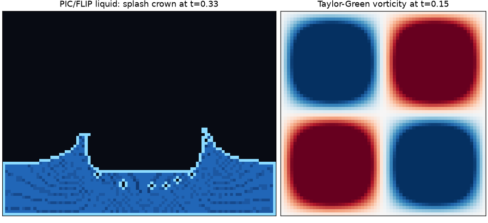
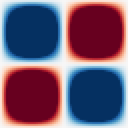

# mackerel

A small, executable fluid-simulation lab built milestone by milestone. The reference solvers
use NumPy on a staggered MAC grid; optional Numba acceleration is available for the M7
particle-transfer kernel.



*Left: the particle-based PIC/FLIP liquid at `t=0.33`, where a falling drop has opened a crown
and a central cavity. Right: the vorticity of a decaying Taylor–Green vortex pair. Both panels
are rendered by this repository's solvers — see [Showcase](#showcase).*

## Quick start

```bash
python -m pip install -e '.[dev]'
python -m pytest -q
ruff check .
mypy
```

Run a validated case or a small scene from the repository root:

```bash
python -m validation.flip          # PIC/FLIP dam break, splash and sloshing
python -m validation.performance   # optional NumPy/Numba benchmark
mackerel run cylinder --n 32 --steps 200
mackerel run dam_break --n 48 --steps 200
mackerel run splash --n 40 --steps 200
mackerel run sloshing --n 40 --steps 200
```

Generated figures, GIFs, CSV/NPZ data and JSON summaries are written below `outputs/` (which
is intentionally gitignored). MP4 output is used when `ffmpeg` is installed; otherwise the
rendering utilities retain GIF output.

## Showcase

Every animation below is generated from the committed solvers by `python -m validation.showcase`
(about 40 s on a CPU) and checked in under `docs/media/`. None of the physics is staged: each
GIF is a sequence of real time steps, and `docs/media/showcase.json` records the grid, time
step, particle count and measured divergence for each one.

| Dam break (95% FLIP) | Splash | Sloshing |
|---|---|---|
|  |  |  |
| `48x36`, `dt=2.5e-4` to `t=.34`: the column collapses and runs out along the floor. | `64x48`, `dt=5e-4` to `t=.30`: a drop falls into a pool and throws up a crown. | `64x48`, `dt=5e-4` to `t=.42`: tilted water settles under gravity. |

| Buoyant plume | Taylor–Green vortices |
|---|---|
|  |  |
| `64x64`, `dt=5e-3` to `t=2.4`: a replenished hot patch rises and mushrooms. | `64x64`, `dt=2.5e-3` to `t=1.2`: vorticity decays under viscosity. |

The liquid images show **particle occupancy**, not a painted interface: the bright rim marks a
liquid cell that touches air, and the shading is the number of particles in a cell. That is why
the free surface is slightly stair-stepped — it is a cell-scale interface, which is exactly what
the solver represents.

## Milestone reports

* [M1 — MAC grid and diagnostics](docs/milestones/M1.md)
* [M2 — Advection schemes](docs/milestones/M2.md)
* [M3 — Pressure projection and iterative solvers](docs/milestones/M3.md)
* [M4 — Diffusion and the split solver](docs/milestones/M4.md)
* [M5 — Lid-driven cavity validation](docs/milestones/M5.md)
* [M6 — Obstacles, cylinder wake and plume demos](docs/milestones/M6.md)
* [M7 — PIC/FLIP free-surface water](docs/milestones/M7.md)

The mathematical conventions and design decisions are collected in [docs/MATH.md](docs/MATH.md)
and [docs/DESIGN.md](docs/DESIGN.md). Validation reference data and its provenance live in
`validation/data/`.
